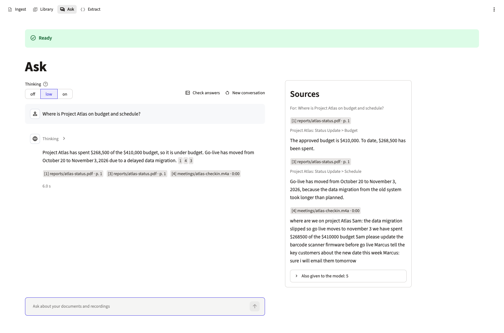
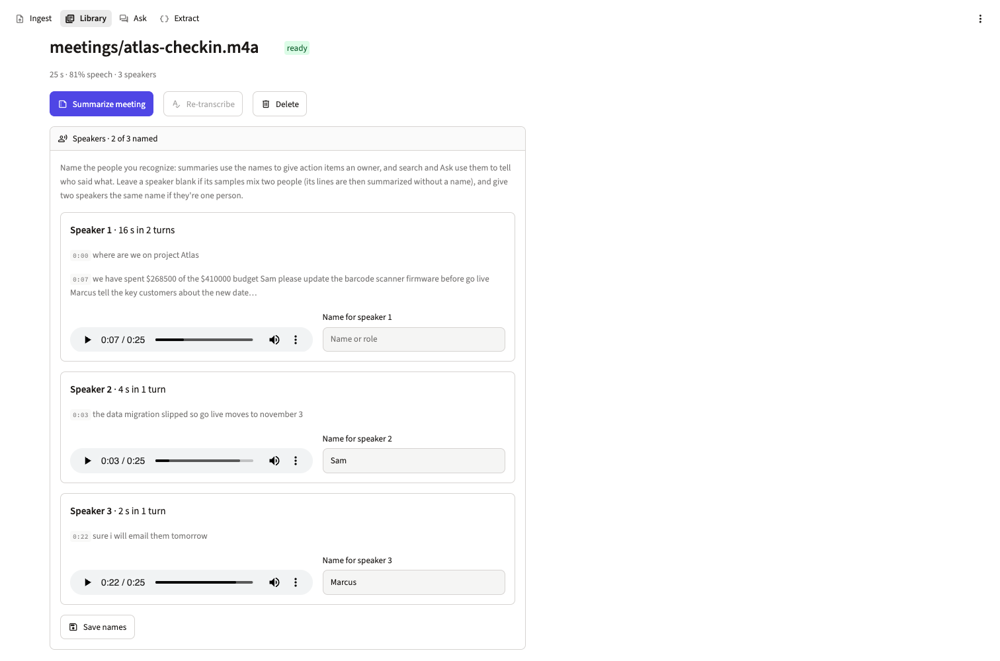
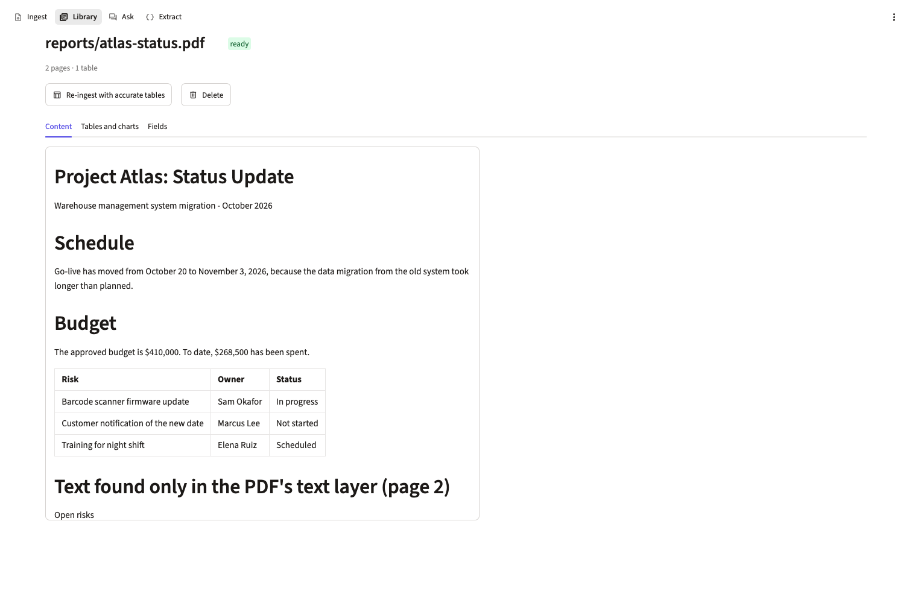
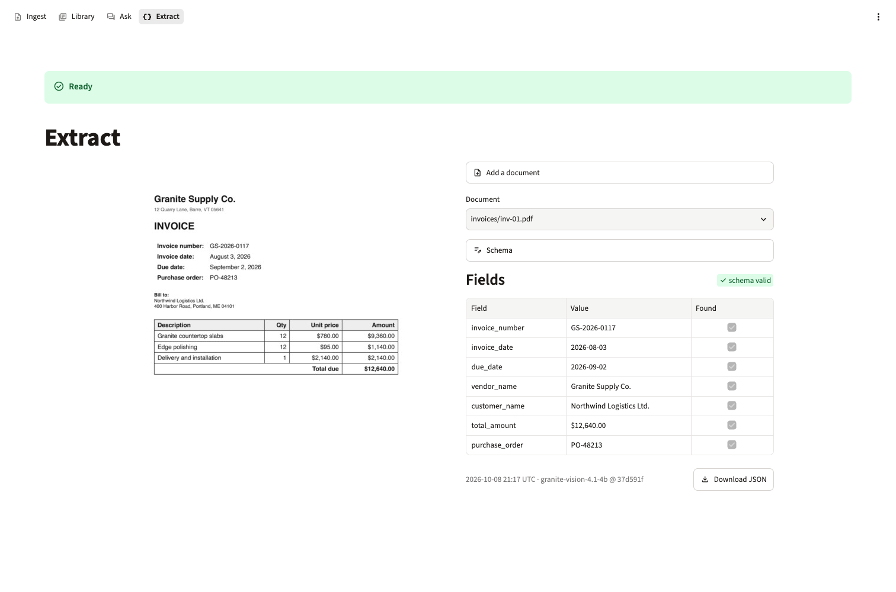

# granit

[](LICENSE)

Private document and meeting intelligence that runs entirely on your Mac. IBM Granite models on MLX transcribe
recordings, convert documents, extract forms and answer questions with citations, from a CLI or a Streamlit app.

The only network traffic is the one-time model download from Hugging Face.

## Features

- **Meetings:** recording → transcript → summary with decisions and action items.
- **Speakers:** see who spoke when, and name the speakers you recognize. Summaries, search and Ask use only the names
  you give.
- **Documents:** PDF or scan → Markdown with accurate tables and chart data.
- **Forms:** document image + JSON Schema → validated JSON.
- **Search and Ask:** hybrid search and cited answers across everything in your library.
- **Answer checks:** Granite Guardian checks that answers are supported by their sources, and checks meeting summaries
  against requirements you write.

## Screenshots

Taken on the public evaluation set (synthetic files in `eval/public/`).

**Ask:** a cited answer drawn from a report and a meeting recording, with the passages it used.

<picture>
  <source media="(prefers-color-scheme: dark)" srcset="docs/screenshots/ask-dark.png">
  
</picture>

**Library, recording:** speakers with their lines and audio samples, two of them named.

<picture>
  <source media="(prefers-color-scheme: dark)" srcset="docs/screenshots/library-recording-dark.png">
  
</picture>

**Library, document:** a PDF converted to Markdown, including its table.

<picture>
  <source media="(prefers-color-scheme: dark)" srcset="docs/screenshots/library-document-dark.png">
  
</picture>

**Extract:** invoice fields as JSON that has been checked against the schema.

<picture>
  <source media="(prefers-color-scheme: dark)" srcset="docs/screenshots/extract-dark.png">
  
</picture>

## Requirements

- Apple Silicon Mac with 32 GB of memory (developed on an M2 Max), macOS 26
- [uv](https://docs.astral.sh/uv/)
- About 30 GB of free disk space for model weights (about 47 GB during setup, until the local builds finish)

## Quick start

```bash
uv sync                                                   # install
uv run granit models download                             # download the pinned models
uv run granit models download guardian-source diarization-source  # download the sources for local builds
uv run granit models convert --delete-source              # build Guardian (8-bit) and diarization (fp32)
uv run granit models smoke                                # check that each model loads
uv run granit ui                                          # open the app
```

## Usage

Run each command with `uv run`. Add `--help` to any command for its options.

| Command | What it does |
|---|---|
| `granit ui` | Open the app: Ingest, Library, Ask and Extract pages |
| `granit ingest FILE…` | Add files to the library |
| `granit sources` | List the library |
| `granit search "question"` | Search with cited hits (`--mode bm25\|vectors\|hybrid\|hybrid+rerank`) |
| `granit ask "question"` | Answer with citations (`--thinking off\|low\|on`) |
| `granit meeting SOURCE` | Summarize a meeting as JSON |
| `granit speakers SOURCE [1=Priya …]` | List or name a recording's speakers |
| `granit verify` | Check answers and summaries that haven't been checked yet |
| `granit transcribe FILE…` | Transcribe audio to timestamped segments |
| `granit convert FILE…` | Convert a PDF or image to Markdown and chart data |
| `granit extract FILE --schema S.json` | Extract form fields as validated JSON |

## Models and licenses

Model weights are **not** part of this repository. They are downloaded from Hugging Face at pinned revisions.

| Model | Role | License | Source |
|---|---|---|---|
| Granite Speech 5.0 470M TurboCTC | Audio → transcript | Apache-2.0 | [ibm-granite/granite-speech-5.0-470m-turboctc](https://huggingface.co/ibm-granite/granite-speech-5.0-470m-turboctc) |
| Silero VAD v6 | Audio → speech segments | MIT | [mlx-community/silero-vad-v6](https://huggingface.co/mlx-community/silero-vad-v6) |
| Granite-Docling 258M (MLX) | Page image → Markdown | Apache-2.0 | [ibm-granite/granite-docling-258M-mlx](https://huggingface.co/ibm-granite/granite-docling-258M-mlx) |
| Granite Vision 4.1 4B | Tables, charts, forms → HTML, CSV, JSON | Apache-2.0 | [ibm-granite/granite-vision-4.1-4b](https://huggingface.co/ibm-granite/granite-vision-4.1-4b) |
| Granite 4.2 8B (q8 MLX) | Answers and summaries | Apache-2.0 | [ibm-granite/granite-4.2-8b-q8-mlx](https://huggingface.co/ibm-granite/granite-4.2-8b-q8-mlx) |
| Granite Embedding English R2 | Search vectors | Apache-2.0 | [ibm-granite/granite-embedding-english-r2](https://huggingface.co/ibm-granite/granite-embedding-english-r2) |
| Granite Embedding Reranker English R2 | Search reranking | Apache-2.0 | [ibm-granite/granite-embedding-reranker-english-r2](https://huggingface.co/ibm-granite/granite-embedding-reranker-english-r2) |
| Granite Guardian 4.1 8B ¹ | Answer checks | Apache-2.0 | [ibm-granite/granite-guardian-4.1-8b](https://huggingface.co/ibm-granite/granite-guardian-4.1-8b) |
| Nemotron 3 Diarization ¹ | Who spoke when | [OpenMDW-1.1](https://openmdw.ai/license/1-1/) | [nvidia/Nemotron-3-Diarization](https://huggingface.co/nvidia/Nemotron-3-Diarization) |

¹ Built locally by `granit models convert`: Guardian as 8-bit MLX, diarization as fp32 MLX.

## Status

Version 1.3.0. All v1 milestones (M0–M7) are built, plus M8 (answer checks), M9 (speakers) and M10 (speaker names in
search and Ask). Both evaluation sets meet the 1.0 quality criteria ([PLAN.md](PLAN.md) §4.9).

## Documentation

- [PLAN.md](PLAN.md): design, milestones and decisions
- [CONTRIBUTING.md](CONTRIBUTING.md): development setup, tests and licensing rules

## License

granit is licensed under the [Apache License 2.0](LICENSE). See [NOTICE](NOTICE).
